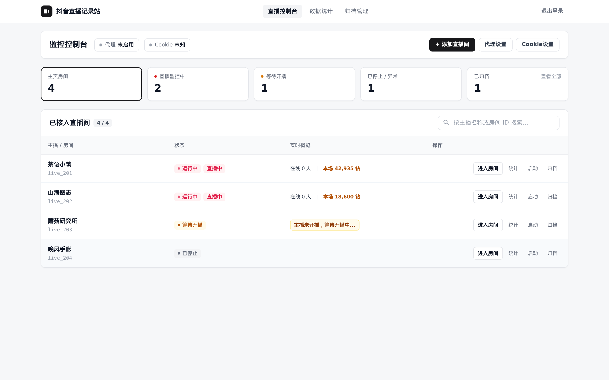
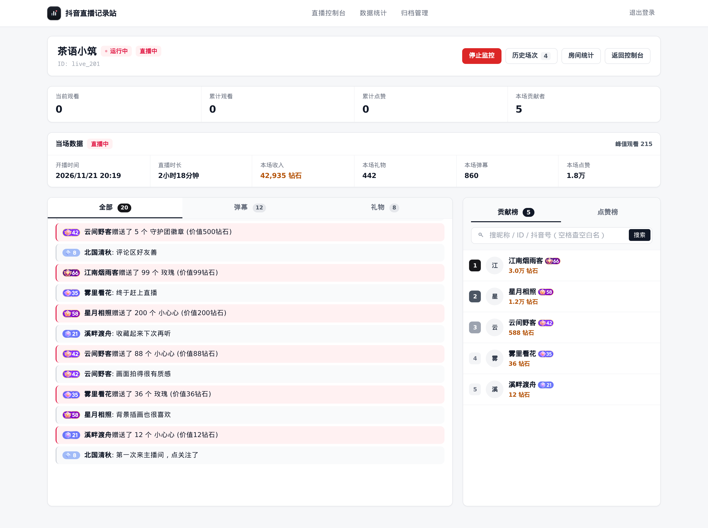
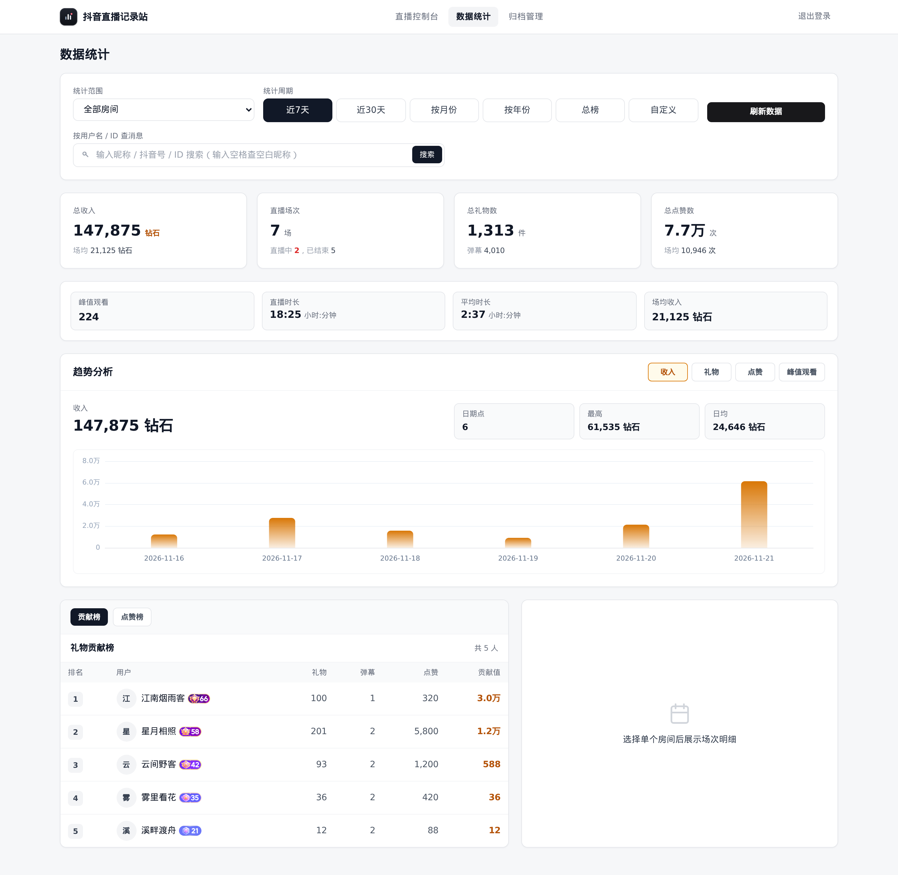
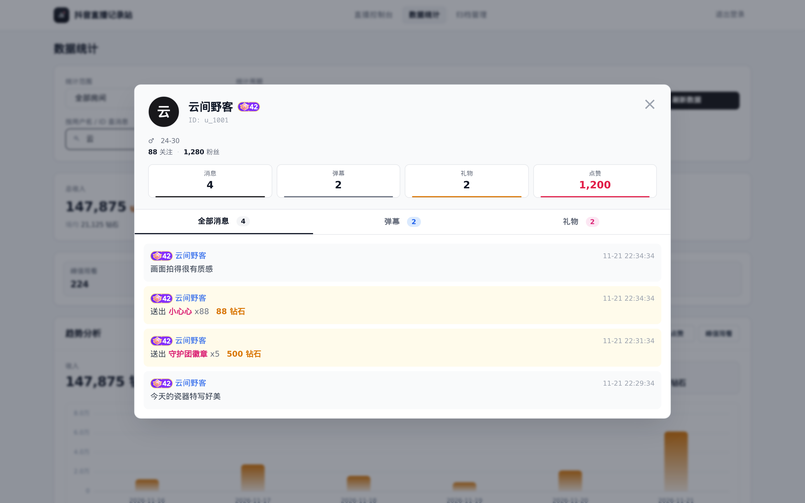

# DouyinLiveHub

一个用于学习 WebSocket、Protobuf 解析与实时数据可视化的个人练手项目。围绕直播场景的公开互动信息（弹幕、礼物、点赞）做本地化记录与图表展示，方便按时段回看、按用户名检索个人历史互动。

[](https://www.python.org/downloads/)
[](https://flask.palletsprojects.com/)
[](https://docs.docker.com/compose/)
[](LICENSE)

> 所有截图均为脱敏 Mock 数据，主播昵称、用户名、礼物记录均为虚构，仅供界面演示。

---

## 一、功能介绍

### 1. 首页：直播监控控制台



- **状态卡片筛选 + 搜索 + 开播置顶**：顶部 5 张统计卡（「主页房间 / 直播监控中 / 等待开播 / 已停止或异常 / 已归档」）支持点击即筛与跳转归档，开播中房间自动置顶并直接显示在线人数与本场收益。
- **粘贴链接快速添加**：新增房间支持纯数字房间号、抖音号或直接粘贴 `live.douyin.com` / App 分享文案，自动提取房间标识并开启 24h 自动开播轮询与错峰防风控探测。
- **快捷设置与归档**：点击顶部「代理 / Cookie」状态胶囊可直接弹出设置；支持单房间归档、恢复与安全二次确认永久删除。

### 2. 房间详情：实时监控与上一场预览



- **开播冷启动回填 & 未开播上一场预览**：进入直播中房间自动回填近期 50 条弹幕/礼物后衔接 Socket.IO 实时推送；主播未开播时自动展示上一场收官消息、贡献榜与房间累计点赞榜，一旦开播即刻清空预览并切入实时流。
- **点昵称查记录**：点击消息流或榜单中任意观众用户名，即可弹窗查看该观众的发言与送礼明细。
- **特殊与盒类礼物定价**：通过新版 Protobuf BUFF 等级价格表、`WebcastBindingGiftMessage` 与盒内关联礼物解析，配合可配置映射解决进阶跑车（如至尊超跑、无界超跑）与礼盒内礼物的计价问题。

### 3. 数据统计：首屏即看与趋势回顾



- 打开即自动加载「全部房间 · 近 7 天」统计，切换房间或时间维度自动无闪烁刷新；支持 `?live_id=...&range=...&session_id=...` URL 跨页深链直达。
- 时间维度覆盖近 7 天 / 近 30 天 / 按月 / 按年 / 总榜 / 自定义日期范围，展示 4 项核心 KPI 与副指标，「场均」分母自动剔除零值场次。
- ECharts 趋势图支持收入 / 礼物 / 点赞 / 峰值观看切换，下方贡献榜、点赞榜与场次明细联动刷新。

### 4. 用户名检索：快速定位


- 在统计页或房间详情页输入用户名，约 350 ms 自动触发模糊匹配，无需手动回车。
- 下拉列出命中候选，附带昵称、所属房间、用户 ID、消息数及累积价值。

### 5. 用户卡片：个人互动回顾



- 展示头像、昵称、用户等级、粉丝团等级、关注/粉丝数与 4 项只读统计概览（消息总数 / 弹幕 / 礼物 / 点赞）。
- 下方 Tab 可按全部 / 弹幕 / 礼物切换查看带时间戳的完整互动明细。

### 其它

- 登录保护：环境变量配置账号密码后，未登录访问自动跳至 `/login`（支持密码明文切换与登录状态反馈）。
- 网络与凭据配置：支持 HTTP / SOCKS5 代理热配置、浏览器 Cookie 运行时更新与手动/定时测活。
- 自定义礼物单价：支持通过 `GIFT_PRICE_OVERRIDES` 环境变量传入 JSON（如 `{"新礼物": 999}`）按名称覆盖或扩展特殊礼物单价。
- 数据保留策略：`DATA_RETENTION_DAYS=0` 表示永久保留本地数据。

---

## 二、快速开始

### 推荐：Docker Compose

```bash
git clone https://github.com/lln556/DouyinLiveHub.git
cd DouyinLiveHub
cp .env.example .env          # 至少改一下 SECRET_KEY 和登录密码
docker compose up -d --build
```

启动完成后访问：

```
http://localhost:7654
```

如果 `.env` 里配置了 `AUTH_USERNAME` 和 `AUTH_PASSWORD`，首次访问会跳到 `/login`。

最小 `.env` 关键项：

```env
APP_PORT=7654
SECRET_KEY=换成随机串
AUTH_USERNAME=admin
AUTH_PASSWORD=换成强密码
# MySQL 由 docker-compose 起，本机直连不用改
MYSQL_ROOT_PASSWORD=root123
MYSQL_PASSWORD=douyin123
# 收不到礼物时再填，可在首页 Cookie 设置里覆盖
DOUYIN_COOKIE=
```

### 备选：本地 uv

需要 Python 3.11+、uv、可访问的 MySQL 8。

```bash
cp .env.example .env
./scripts/install.sh          # uv sync
./scripts/init-db.sh          # 创建表
./scripts/run.sh              # 启动 app.py
```

完整环境变量与故障排查见 [`.env.example`](.env.example) 与 [`docs/`](docs/)。

---

## 三、免责声明

本项目仅用于个人学习研究与技术交流，**严禁**用于以下用途：

- 商业谋利、广告获客、二次售卖采集数据。
- 破坏抖音及第三方系统、扰乱平台秩序、规避风控。
- 盗取、贩卖、滥用用户个人信息、隐私或登录凭证。
- 任何违反所在国家或地区法律法规的行为。

使用者需自行承担因不当使用产生的全部法律风险与后果。本项目作者不对滥用造成的任何损害负责。

如本项目内容涉及侵权或其他权益问题，请通过 issue 或邮件联系维护者，确认后会在合理时间内处理。

---

## 致谢

本项目基于 [saermart/DouyinLiveWebFetcher](https://github.com/saermart/DouyinLiveWebFetcher) 二次开发，采用 GNU Affero General Public License v3.0。
