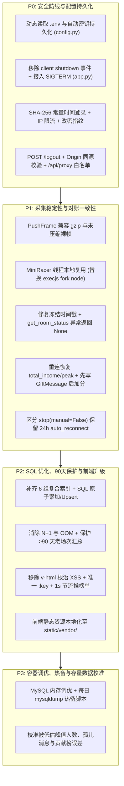

# 系统安全加固、采集稳定性与性能优化设计方案

- 日期：2026-11-21
- 状态：已与用户确认

## 背景与目标

经过对 DouyinLiveHub 全栈代码（前端模板与脚本、Flask + Socket.IO 应用层、爬虫签名与传输层、业务聚合与定时调度层、MySQL 数据模型）及容器部署配置的全面审计，确认系统在多房间管理、连击礼物增量入库、`anchor_id` 跨房合并以及 Cookie 三态测活方面具备良好的工程基础，但同时在以下五个维度存在明确缺陷：

1. **Web 鉴权与配置安全**：弹幕/礼物消息直接拼接未转义 HTML 并在前端通过 `v-html` 渲染；存在客户端可触发的 `shutdown` Socket.IO 事件；默认占位 `SECRET_KEY` 未做启动保护；登录比对在非 ASCII 字符下抛异常且缺少防爆破/CSRF 保护；网页动态修改的 `DOUYIN_COOKIE` 在容器重启后易被旧环境变量覆盖。
2. **爬虫签名与运行时维护**：`get__ac_signature` 默认时间戳在模块导入时冻结；每次轮询通过 `execjs` 拉起 `node` 子进程计算 `a_bogus`；每次 WS 重连重读 474KB `sign.js` 并新建 V8 实例；未压缩 Protobuf 帧因无条件 `gzip.decompress` 持续解析失败丢包；`get_room_status()` 缺少 HTTP 状态校验导致上游 502/风控空响应误判为下播；优雅停机 `shutdown()` 误将 24h 房间的 `auto_reconnect` 置为 `False`；轮询临时 `requests.Session` 未关闭。
3. **数据去重、重连恢复与 90 天保留保护**：WS 重连新建 `WebDouyinLiveFetcher` 时未预加载本场 `total_income` 与 `peak_viewer_count` 导致峰值被覆盖变小；礼物先写 `UserContribution` 后写 `GiftMessage`，触发 `trace_id` 冲突后仍累加贡献分；`group_id == 0` 判真漏洞与乱序连击重插导致边界计数异常；>90 天历史场次明细被清理后若触发 `end_live_session` 会将 `total_income` 清零；归档汇总混合 90 天内外数据时退化为仅统计近期流水。
4. **SQL 性能与前端交互体验**：贡献榜日期查询存在 `4N+2` 次 N+1 查询；`get_user_messages(message_type='all')` 无 SQL 分页直接全量拉入内存；`increment_session_stats` / `update_user_contribution` 采用 Python 读改写而非 SQL 原子更新；缺少高频查询复合索引；前端依赖外部 CDN 存在国内白屏风险；搜索框 `@blur` 调用 `setTimeout` 在 Vue 2 下必报错；500 条滑动窗口 `:key="index"` 引发全量 DOM 重绘；收到礼物/弹幕不实时推榜单与本场收入。
5. **存储选型与运维保障**：明确 MySQL 8.0 vs PostgreSQL 架构选型，优化容器内存占用并建立每日无锁热备与存量数据校准机制。

目标：在不破坏现有功能与测试兼容性的前提下，分模块彻底修复上述安全、稳定性、数据一致性和性能问题。

---

## 数据库选型决策：保留 MySQL 8.0

针对是否需要将数据库从 MySQL 8.0 迁移至 PostgreSQL，结合本项目的读写模型与代码耦合度评估如下：

| 评估维度 | MySQL 8.0（InnoDB，最终选择） | PostgreSQL |
| :--- | :--- | :--- |
| **高频热点行更新模型** | **高度契合**：直播期间每条弹幕、点赞、连击礼物高频更新同一批 `live_sessions` 和 `user_contributions` 行，InnoDB 对非索引列采用原地更新，写放大低、表体积稳定。 | **存在写放大风险**：MVCC 每次 `UPDATE` 本质生成新行版本（`DELETE + INSERT`），高频刷新同一场次/用户行会产生大量死元组，依赖高频 `autovacuum` 调优。 |
| **模糊昵称检索（`%keyword%`）** | 普通 B-Tree 对前导通配符无效，中小体量（百万行内）可接受，配合限流与分页可控制耗时。 | 支持 `pg_trgm` + GIN 索引加速任意子串 `ILIKE`，是其突出强项。 |
| **代码方言耦合与迁移成本** | **零迁移风险**：现有 ORM 模型、自迁移 DDL、测试清理脚本完全适配 MySQL 8.0。 | 需改造至少 5 处耦合：`UNION ALL` 空列类型转换、`DATETIME` DDL、aware/naive 时区混用、`ON CONFLICT` 语法、测试固件 `FOREIGN_KEY_CHECKS` 逻辑。 |
| **当前性能瓶颈归因** | 当前慢查询来自应用层 400+ 次 N+1 SQL、无 `LIMIT` 拉全表、单条消息拆 3 个事务与缺失索引，非存储引擎本身瓶颈。 | 换库不解决代码层 N+1 与事务拆分问题。 |

**结论**：保留 **MySQL 8.0**，在 `docker-compose.yml` 中增加 `--performance-schema=OFF` 与 `--innodb-buffer-pool-size=128M` 控制容器内存开销，通过代码层 SQL 原子化、批量查询与索引补齐解决性能问题，同时配套每日自动压缩热备脚本。

---

## 总体改造架构与阶段划分

---

## 详细技术设计

### 模块 1：Web 安全加固与配置持久化

**涉及文件**：`config.py`、`app.py`、`api/rooms.py`、`templates/*.html`

1. **修复容器重启后 Cookie 被旧环境变量覆盖（`config.py`）**
   - 问题：`docker-compose.yml` 通过 `environment` 注入 `DOUYIN_COOKIE=${DOUYIN_COOKIE:-}`，容器重启时旧进程环境变量仍在；`config.py:10` 调用 `load_dotenv()` 未传 `override=True`，导致界面更新写入 `.env` 的新 Cookie 重启后被忽略。
   - 方案：在 `config.py` 中使用 `dotenv.dotenv_values(BASE_DIR / '.env')` 读取持久化的 `DOUYIN_COOKIE`，当 `.env` 文件存在有效值时优先采用 `.env` 的值。同时更新 `docker-compose.yml` 避免无意义注入空环境变量遮蔽 `.env`。

2. **强制密钥安全与 Session Cookie 标志（`config.py`、`app.py`）**
   - 检测 `SECRET_KEY` 是否为空或命中默认占位值（`'your-secret-key-change-in-production'`、`'change-this-secret-key-in-production'`、`'your-secret-key'`）。若是，则自动从 `data/.secret_key` 读取或用 `secrets.token_hex(32)` 生成并写入该文件（权限 `0600`），同时打印告警日志。
   - 当 `AUTH_REQUIRED` 为 `False` 时在启动日志打印显式安全提示。
   - 在 Flask 配置显式设置 `SESSION_COOKIE_HTTPONLY = True`、`SESSION_COOKIE_SAMESITE = 'Lax'`、`SESSION_COOKIE_SECURE`（由环境变量控制，兼容内网 HTTP 与反代 HTTPS）。
   - `SOCKETIO_CORS_ALLOWED_ORIGINS` 默认改为同源（`None` / 不设通配符 `'*'`），避免跨站任意网页直连 Socket.IO。

3. **移除客户端 `shutdown` 事件与日志脱敏（`app.py`）**
   - 彻底删除 `@socketio.on('shutdown')`（`app.py:449-456`），改为在主入口注册 `signal.SIGTERM` 和 `signal.SIGINT` 处理器执行 `stop_status_display()`、`room_manager.shutdown()`、`scheduler_service.stop()` 与 `data_service.close_session()`。
   - 将 `app.py:477` 启动日志改为 `make_url(config.DATABASE_URL).render_as_string(hide_password=True)`，消除日志明文泄露数据库密码。
   - 将 APScheduler 初始化（含 `cookie_health_tick` 立即首次执行 `next_run_time=get_china_now()`）封装为幂等辅助函数，确保无论直接执行 `python app.py` 还是 WSGI 启动都能完整注册后台任务。

4. **登录鉴权、防爆破、CSRF 与开放重定向修复（`app.py`、`templates/*.html`）**
   - **非 ASCII 安全比对**：对输入的和配置的账号密码分别做 `hashlib.sha256(s.encode('utf-8')).digest()` 后再调 `secrets.compare_digest`，修复 `app.py:154-155` 传入中文密码抛 `TypeError` 报 500 的问题。
   - **凭据指纹失效**：在 `session['auth_fp']` 记录当前 `AUTH_USERNAME` + `AUTH_PASSWORD` 的 SHA-256 前缀；`is_authenticated()` 校对指纹一致，确保修改密码后旧的 30 天 Cookie 立刻失效。
   - **防爆破限流与失败审计**：增加线程安全按客户端 IP（取 `request.remote_addr`）统计的滑动窗口限流（5 分钟内失败 ≥ 8 次返回 `429`），每次失败打印 `logger.warning`。
   - **开放重定向修复**：`get_safe_next()`（`app.py:135-141`）先将 `next_url` 中的 `\` 替换为 `/`，再校验不以 `//` 开头且 `urlparse` 无 `scheme`/`netloc`。
   - **同源 CSRF 防护与 `POST /logout`**：将 `/logout` 改为仅支持 `POST` 并同步将各页面导航栏退出按钮改为 `<form method="post" action="/logout">`；在 `before_request` 中对所有状态变更请求（`POST`/`PUT`/`PATCH`/`DELETE`）校对 `Origin`（或回退 `Referer`）主机与 `request.host` 一致（允许无 `Origin`/`Referer` 的非浏览器客户端或测试客户端兼容开关，浏览器跨站提交一律拦截返回 `403`）。
   - **Socket.IO `join` 鉴权与类型保护**：`handle_join(data)` 复检 `is_authenticated()` 并校验 `isinstance(data, dict)`。

5. **原子写 `.env` 与接口参数严校验（`app.py`、`api/rooms.py`）**
   - `update_env_value()` 加锁并用临时文件 + `os.chmod(0o600)` + `os.replace()` 原子替换 `.env`，Cookie 值先剔除误带的前缀 `Cookie:` 并转义 `\`、`"` 与 `$`（或单引号写入）避免 `dotenv` 展开损坏。
   - `POST /api/proxy`（`app.py:237-260`）：校验 `isinstance(data, dict)`、`isinstance(enabled, bool)`、`type in ('http', 'socks5')`、`1 <= int(port) <= 65535`，`host` 匹配合法主机名/IP 正则（禁止 `@`/`/`/空白字符）。
   - `api/rooms.py`：`live_id` 校验正则收紧为 `^[A-Za-z0-9_.\-]{1,50}$`；新增 `_parse_int_param()` 校验 `limit`/`offset`/`page`/`page_size`/`hours`/`session_id` 上下界，防止 `limit=0` 除零或负数绕过上限；统一在 `except Exception` 中服务端记录堆栈，响应体仅返回脱敏提示（不泄露 SQLAlchemy 内部信息）。

---

### 模块 2：核心爬虫、签名引擎与运行时线程维护

**涉及文件**：`crawler/signature.py`、`crawler/fetcher.py`、`services/room_manager.py`、`services/scheduler_service.py`、`services/cookie_health.py`、`utils/logger.py`、`utils/status_display.py`

1. **修复时间戳冻结与 `MiniRacer` 常驻复用（`crawler/signature.py`、`crawler/fetcher.py`）**
   - `signature.py:11` 将 `one_time_stamp: int = int(time.time())` 改为 `one_time_stamp: int = None`，函数体内动态取值 `int(time.time())`，并对 `one_nonce` 做 `or ""` 兜底防止 `TypeError`。
   - `fetcher.py` 使用模块级只读缓存加载 `a_bogus.js` 和 `sign.js` 源码，结合 `threading.local()` 为每个工作线程懒初始化并复用 `MiniRacer` 实例，同时替代 `execute_js()` 中的 `execjs.compile` 路径（保留函数名兼容外部导入但内部走 `MiniRacer` 复用）。彻底消除每分钟 `fork node` 子进程与重复编译 474KB JS 的 CPU/内存抖动。若 `generateSignature` 返回空则抛明确异常不拼 `&signature=None`。

2. **WebSocket 帧双格式解析与防误判下播（`crawler/fetcher.py`、`ws_handlers/handlers.py`）**
   - 新增工具函数 `decompress_push_frame_payload(package: PushFrame) -> bytes`：优先检查 `package.payload[:2] == b'\x1f\x8b'` 或 `package.headers_list` 中 `compress_type == 'gzip'`；满足时调用 `gzip.decompress`，否则直接返回原始 `package.payload` 字节，空载荷跳过解析。消除未压缩 Protobuf 帧引发的 `Not a gzipped file` 报错丢帧。
   - `get_room_status()`（`fetcher.py:503-534`）：在 `self.session.get(...)` 后调用 `resp.raise_for_status()`；将空响应、非 JSON、缺失 `data` 或 `room_status` 的风控/网关异常情况统一返回 `None`（状态未知），仅在拿到明确非零 `room_status` 时返回 `False`。
   - `_get_anchor_info_from_html()`（`fetcher.py:408-426`）：收紧 `anchor_id` 匹配规则，仅从 `owner` 结构片段提取 `id_str`/`id`，严禁全局扫描第一个 `"id"`。
   - 新增 `DouyinLiveWebFetcher.close()` 关闭底层 `self.session`；`stop()` 安全判空 `self.ws` 并同时关闭 `ws.sock` 加速中断阻塞读。

3. **房间生命周期与线程安全加固（`services/room_manager.py`、`services/scheduler_service.py`、`services/cookie_health.py`）**
   - `MonitoredRoom.stop(self, manual: bool = True)`：仅当 `manual=True` 时写 `auto_reconnect=False`、触发下播状态检查并记“用户手动停止”；`room_manager.shutdown()` 调用 `monitored_room.stop(manual=False)`，保留数据库 24h `auto_reconnect` 配置并短等待子线程收尾。
   - `_poll_room_status()`（`room_manager.py:382-436`）：在 `try ... finally:` 中确保调用 `temp_fetcher.close()` 释放 TLS 连接池；将 `getattr(self.fetcher, "status_error_message", None)` 修正为 `temp_fetcher.status_error_message`；若轮询阶段拿到主播名称和 `anchor_id` 立即顺带更新 `LiveRoom`；轮询休眠改用 `self.shutdown_event.wait(poll_interval)` 实现秒级退出。
   - 重连退避（`room_manager.py:305`）：引入基于 `reconnect_count` 的退避与 `apply_jitter`，并用 `self.shutdown_event.wait(delay)` 替代不可中断的 `time.sleep`；仅在 `is_live is True` 进入建连流程或 WS 真正建连后才写 `last_connect_time`；收到 `ControlMessage(status=3)` 后直接进入轮询或平稳退出而不再虚假写 `'stopped'` 闪烁 30 秒；`check_and_end_session_if_offline()` 仅在存在活跃场次或首次到达阈值时执行 DB 查询与打日志。
   - **线程锁补齐**：`MonitoredRoom` 新增 `data_lock` 保护 `user_contributions`、`combo_gifts`、`dedupe` 缓存读写；`RoomManager.active_rooms` 的所有跨线程枚举（`api/rooms.py`、`scheduler_service.py`、`status_display.py`）统一先在 `room_manager.lock` 下拷贝快照再做 I/O/DB 操作。
   - **Cookie 健康检测优化（`services/cookie_health.py`）**：将 `requests.get` 网络探测移出 `self._lock`，状态字段读写与 `snapshot()` 统一加锁；`COOKIE_HEALTH_CHECK_INTERVAL == 0` 时一并尊重用户关闭自动探测意图或增加明确开关；当 `status_code` 为非未登录类限流错误且无明确未登录特征时谨慎处理；`dead -> unconfigured -> healthy` 也正确记录恢复事件。
   - **日志与终端状态面板（`utils/logger.py`、`utils/status_display.py`）**：`logger.add()` 文件 sink 增加 `enqueue=True` 异步安全落盘，为 `error_{time}.log` 启用按周期和体积混合轮转确保旧错误日志按 `LOG_RETENTION` 自动过期；修复 `status_display.py` Rich 模式下未更新 `_first_run = False` 的问题。

---

### 模块 3：数据采集去重、90 天保留保护与 MySQL 性能优化

**涉及文件**：`ws_handlers/handlers.py`、`models/database.py`、`services/data_service.py`、`app.py`（`migrate_database`）

1. **WS 断线重连状态预加载与实时榜单节流推送（`ws_handlers/handlers.py`、`services/room_manager.py`）**
   - `_preload_session_data()` 与 `_wsOnOpen()` 续接已有 `status == 'live'` 场次时，除预加载 `user_contributions` 外，同步恢复：
     - `self.total_income = float(current_session.total_income or 0)` 与 `self.monitored_room.stats['total_income']`
     - `self.max_viewer_count = int(current_session.peak_viewer_count or 0)`
     - 预加载本场送礼 `user_id` 集合到 `monitored_room.gift_users`（修正原先存 `nick_name` 且跨重连清空的问题）。
   - 修复 `handlers.py:865`：在 `_handle_stats_message` 顶部统一赋值 `data_service = self.monitored_room.manager.data_service`，消除 `current_session_id is None` 时的 `UnboundLocalError`。
   - 将 `trace_dedupe`（使用 `collections.deque(maxlen=2000)` + `set`）与 `like_dedupe` 提升至 `MonitoredRoom`，仅在 `_wsOnOpen` 新建 `LiveSession` 时与 `user_contributions`、`combo_gifts`、`stats['total_income']` 一同重置。
   - **1 秒节流实时推送 `_emit_room_stats_throttled()`**：收到礼物、弹幕（或有关键变化时）以及 `_wsOnOpen` 建好新场次后触发节流刷新 `room_{live_id}_stats`，前端无需等待下一个 `RoomUserSeqMessage` 即可实时跳动本场收入、礼物数与贡献榜；点赞日志由 `INFO` 降级为 `DEBUG`。

2. **礼物精准解析、先落库后计分与防重入账（`ws_handlers/handlers.py`）**
   - 修复 `#L317` 笔误：`hasattr(gift_msg.user, 'id_str')`。
   - 去重键优先取 `trace_id`，为空时回退 `common.msg_id`（`f"msg:{msg_id}"`），防空 `trace_id` 连击结束包重放翻倍。
   - 修复 `group_id == 0` 判真：仅当 `getattr(gift_msg, 'group_id', 0)` 非零时视为有 `group_id`；`per_combo_count = (gift_msg.group_count or 0) or (getattr(gift_msg, 'repeat_count', 0) or 0) or 1`。
   - **先写 `GiftMessage` 再加分**：新增普通礼物或新连击序列首帧时，先调用 `data_service.save_gift_message(...)`；只有返回非 `None` 才执行 `self.total_income += ...`、`monitored_room.update_contribution(...)` 和 `data_service.increment_session_stats(...)`，彻底消除 `trace_id` 唯一键冲突后仍累加贡献榜的漂移。
   - 连击乱序包（`current_count <= last_count`）直接跳过，不再重置 `db_id=None`；每次更新维护 `combo_gifts[key]['updated_at']` 并定期清理超过 10 分钟未更新的残留连击条目。
   - 修复普通礼物展示文案中的金额为 `total_gift_value`；控制消息结束直播时把状态更新与下播逻辑解耦，避免同批次后续帧成为孤儿消息。

3. **MySQL 索引补齐、原子更新与连接池扩容（`models/database.py`、`app.py`、`services/data_service.py`）**
   - 在 `models/database.py` 与 `migrate_database()` 中幂等补齐 6 组索引：
     - `idx_room_anchor_id` on `live_rooms(anchor_id)`
     - `idx_chat_session_time` on `chat_messages(live_session_id, created_at)`
     - `idx_chat_user_time` on `chat_messages(user_id, created_at)`
     - `idx_gift_session_time` on `gift_messages(live_session_id, created_at)`
     - `idx_contribution_global_score` on `user_contributions(total_score)`
     - `idx_contribution_room_likes` on `user_contributions(live_id, like_count)`
   - 连接池扩大为 `pool_size=15, max_overflow=25`。
   - `increment_session_stats` 改为单条 SQL 原子 `UPDATE live_sessions SET total_income = total_income + :inc ... WHERE id = :id`。
   - `update_session_stats` 更新 `peak_viewer_count` 时改用 `func.greatest(func.coalesce(LiveSession.peak_viewer_count, 0), val)`，数据库层保证峰值单调不减。
   - `update_user_contribution` 改为 `sqlalchemy.dialects.mysql.insert(UserContribution).on_duplicate_key_update(...)` 单条原子 Upsert（`total_score = total_score + VALUES(total_score)` 等），移除冗余 `session.refresh()` 与先查后改竞争。

4. **90 天保留保护、N+1 消除与统计口径统一（`services/data_service.py`）**
   - **`cleanup_old_data` 与 `end_live_session` 互锁保护**：
     - `cleanup_old_data` 仅清理归属非 `'live'` 场次（或无场次）且早于 `cutoff_date` 的明细，并采用 `LIMIT 10000` 循环分批提交避免长锁表。
     - `end_live_session` 改为用 `float(gift_agg[0])`（或 `round(..., 2)`）避免截断小数，同时校准 `total_chat_count`；**关键保护**：若场次开始时间早于 `now - DATA_RETENTION_DAYS`（当保留天数 > 0），或场次已处于 `'ended'` 且该场在 `gift_messages` 为 0 行而原 `total_income > 0`，严禁用 `0` 覆盖保留汇总值！
   - `cleanup_stale_live_sessions`：不再硬编码 `start_time + timedelta(hours=2)`，而是查询该场次 `MAX(ChatMessage.created_at)`、`MAX(GiftMessage.created_at)` 与 `stale_session.updated_at` 的最大值作为 `end_time`，并校准保留期内场次汇总。
   - `get_archived_rooms_summary`：改为 `max(gift_income, session_income)`（礼物数、弹幕数同理），并通过聚合子查询替代逐房间 4 连查。
   - `get_contributors_by_date_range`：将 `for row in results` 内的 400+ 次逐行查询替换为基于当页 `(live_id, user_id)` 列表的 **3 次批量 `IN` 查询**；将 `gift_count` 统一为 `func.sum(GiftMessage.gift_count)`，与“总榜”和场次汇总对齐；对 `ilike` 搜索词转义 `%`、`\`、`_`。
   - `get_user_messages(message_type='all')` 与 `get_all_messages`：内层 `chat` 和 `gift` 子查询各自先执行 `.order_by(created_at.desc()).limit(offset + limit)` 后再合并排序切片，消除 OOM 全表拉取风险；若按 `session_id` 查询当前场次但该用户在该场仅有记录而无弹幕礼物时，不把 `UserContribution` 全历史总量错冒充成单场次统计。
   - 修复 `create_live_room` 冲突路径调用不存在方法名 `get_live_room_by_live_id` 的笔误；修复 `get_stats_summary()` 将 `waiting`/`error` 等非活跃非停止状态合理归类使卡片总数闭合。

---

### 模块 4：前端去 XSS、静态资源本地化与交互修复

**涉及文件**：`static/vendor/*`（新增）、`templates/*.html`、`static/js/*.js`

1. **移除 `v-html` 根治 XSS & 稳定 `:key` 消除 DOM 抖动（`templates/room.html`、`static/js/room.js`、`ws_handlers/handlers.py`）**
   - 后端推送 `room_{live_id}` 结构化字段（`user`, `user_id`, `user_level`, `fans_club_level`, `content` 纯文本, `gift_name`, `gift_count`, `total_value`, `is_combo_end`, `partial_count`）。
   - `room.html` 消息流删除 `v-html="msg.content"`，改用纯 `v-text` + 属性绑定渲染等级图标、粉丝团图标、可点击高亮用户名、弹幕正文或礼物文案，彻底阻断 DOM XSS；同时保留对历史兼容纯文本字段的兜底显示（使用 `v-text`）。
   - `room.js` 为每条收到的实时消息分配自增客户端唯一序号 `_id: ++this._msgSeq`，`room.html` 绑定 `:key="msg._id"`（榜单改用 `:key="item.user_id"`），消除满 500 条后每次 `shift+push` 重解析 500 个节点的卡顿。
   - 模板中的 `messages.filter(...).length` 移入 Vue `computed` 属性；滚到底部操作合入 `requestAnimationFrame`，滚动监听加 `{ passive: true }`。

2. **静态资源本地化与样式修复（`static/vendor/`、`templates/*.html`）**
   - 下载校验生产压缩版 `vue@2.6.14` (`vue.min.js`)、`socket.io-client@4.7.x` (`socket.io.min.js`)、`tailwindcss@2.2.19` (`tailwind.min.css`)、`echarts@5.5.x` (`echarts.min.js`) 存至 `static/vendor/`，全部 5 个 HTML 模板改从 `/static/vendor/...` 加载；移除 `login.html` 未使用的 Vue 引用。
   - 将模板中 Tailwind v3 类名 `shrink-0`、`bg-amber-50`、`border-amber-200`、`text-amber-800`、`to-emerald-50` 替换为 Tailwind v2 等效类名；所有外链抖音头像 `` 添加 `referrerpolicy="no-referrer"`。

3. **具体前端交互 Bug 修复（`templates/room.html`、`templates/stats.html`、`static/js/*.js`）**
   - `room.html:723` 与 `stats.html:364`：将 `@blur="setTimeout(...)"` 改为 `@blur="onUserSearchBlur"`，在组件 `methods` 中调用 `window.setTimeout`。
   - `room.js`：协调首屏并发请求与 WS `join` 状态合并，不再用 `?limit=100` 的 `contributors.length` 覆盖真实的 `contributorCount`；当 `currentSession` 从活跃变为结束时主动调用 `loadHistorySessions()` 刷新“上次直播”卡片；对齐 `likeRankInfo` 与 `contributorInfo` 的下播清空逻辑；10 秒定时轮询仅在 `!document.hidden` 时发起，无数据时不覆盖。
   - `stats.js` & `stats.html`：修复切换房间触发 `watch` 与 `@change` 冲突导致切换“全部房间”隐藏点赞榜的问题；为 `loadData()` 增加递增请求序列号防乱序覆盖；增加自定义日期起止大小校验并允许选择今天；对拼入 URL 的 `live_id` 使用 `encodeURIComponent`；场次详情弹窗礼物清单补全普通多数量礼物的数量展示；清理废弃 SVG 趋势图遗留死代码。
   - `index.js` & `index.html`：保存 5s 轮询定时器句柄并在 `beforeDestroy` 清理、页面隐藏时暂停轮询；补齐 `'waiting'` 状态文案与样式；修正代理设置保存弹窗的误导文案（说明即时作用于新连接）；弹窗增加遮罩点击与 `Escape` 关闭。

---

### 模块 5：本机运维调优、每日热备与存量数据校准

**涉及文件**：`docker-compose.yml`、`scripts/backup_db.sh`（新增）、`services/scheduler_service.py`、`scripts/repair_historical_data.py`（新增只读核对/幂等校准工具）

1. **MySQL 容器内存调优（`docker-compose.yml`）**
   - 在 `db.command` 下增加 `--performance-schema=OFF` 与 `--innodb-buffer-pool-size=128M`，把数据库常驻内存从 ~384MB 压低到 ~160MB 区间。
2. **每日自动无锁热备（`scripts/backup_db.sh`、`services/scheduler_service.py`）**
   - 新增 `scripts/backup_db.sh`：调用 `mysqldump --single-transaction --quick --routines --triggers`（支持容器内/宿主机环境变量读取连接信息）压缩输出至 `data/backups/douyin_live_YYYYMMDD_HHMMSS.sql.gz`，自动清理超过 14 天的备份。
   - `SchedulerService` 注册每日固定时段（如 `04:30` `CronTrigger`）自动触发一次轻量热备（或由系统 cron 调用脚本，提供配置开关控制），并在执行校准前先生成全库快照。
3. **存量数据无损校准逻辑（执行阶段按需运行）**
   - **峰值人数校准**：对比 `live_sessions` 与同期 `room_stats`（`stats_at BETWEEN start_time AND COALESCE(end_time, NOW())`），对 `MAX(room_stats.current_user_count) > live_sessions.peak_viewer_count` 的场次向上补齐真实峰值。
   - **孤儿消息归属**：对 `live_session_id IS NULL` 的少量边界消息，按 `live_id` 与消息时间落在对应 `live_sessions` 窗口（允许下播后 ±5 秒宽限）自动关联回所属 `live_session_id`。
   - **贡献榜对齐**：对未经过 90 天明细清理的完整房间，核对 `user_contributions.total_score` 与 `gift_messages` 分用户求和差异并做精确对平。

---

## 改动文件清单汇总

| 文件 | 改动性质 | 所属模块 |
| :--- | :--- | :--- |
| `config.py` | 修改 | 模块 1（配置、密钥持久化、Cookie 优先读 `.env`） |
| `app.py` | 修改 | 模块 1/3（安全加固、CSRF、SIGTERM、原子写 `.env`、索引迁移） |
| `api/rooms.py` | 修改 | 模块 1/3（参数校验、脱敏报错、消除列表 N+1） |
| `crawler/signature.py` | 修改 | 模块 2（修复时间戳冻结与空 nonce） |
| `crawler/fetcher.py` | 修改 | 模块 2（`MiniRacer` 复用、未压缩帧兼容、状态异常返回 `None`、正则收紧） |
| `ws_handlers/handlers.py` | 修改 | 模块 2/3/4（结构化消息防 XSS、重连恢复、先落库后计分、节流推榜单） |
| `services/room_manager.py` | 修改 | 模块 2/3（`manual=False` 保护、连接池关闭、锁保护、去重提升） |
| `services/scheduler_service.py` | 修改 | 模块 2/5（快照遍历、`04:30` 热备任务注册） |
| `services/cookie_health.py` | 修改 | 模块 2（I/O 移出锁外、状态读写加锁） |
| `models/database.py` | 修改 | 模块 3（补齐 6 组高频索引） |
| `services/data_service.py` | 修改 | 模块 3（原子累加/Upsert、90 天防清零、消除 N+1 与 OOM） |
| `utils/logger.py`、`utils/status_display.py` | 修改 | 模块 2（异步日志 `enqueue`、错误日志轮转、Rich 模式 `_first_run`） |
| `static/vendor/*` | 新增 | 模块 4（Vue / Socket.IO / Tailwind / ECharts 本地化） |
| `templates/*.html`、`static/js/*.js` | 修改 | 模块 1/4（去 `v-html`、修 `@blur`、`:key` 优化、POST 登出、交互修复） |
| `docker-compose.yml`、`scripts/backup_db.sh` | 修改/新增 | 模块 1/5（MySQL 内存参数、每日自动热备） |
| `tests/*` | 新增/修改 | 全模块（安全、采集、重连、对账、前端 E2E 回归测试） |

---

## 验证策略

1. **自动化单元测试与集成测试**：通过 `./scripts/test.sh unit`、`./scripts/test.sh integration` 与 `./scripts/test.sh e2e` 验证：
   - 安全测试：默认密钥告警/生成、非 ASCII 密码登录、IP 爆破限流、`get_safe_next` 反斜杠拦截、跨站 `Origin` 拒绝、`POST /api/proxy` 非法参数拦截、XSS 文本转义/结构化渲染验证。
   - 采集与对账测试：未压缩与 gzip `PushFrame` 双解析、`get_room_status` 502 返回 `None`、`stop(manual=False)` 保留 `auto_reconnect=True`、重连回放 `trace_id` 冲突不重复加分、峰值人数不被向下覆盖、>90 天已清理场次对账不清零、N+1 查询数量回归断言与 `get_user_messages` 分页边界测试。
2. **线上容器与实测验证**：
   - 验证容器重建/重启后 Cookie 配置持久生效、MySQL 常驻内存下降、`SHOW INDEX` 确认索引就位、`logs/error_*.log` 不再出现 `Not a gzipped file` 且无数据库明文密码日志、`data/backups/` 成功产出可解压校验的 `.sql.gz` 备份文件。
